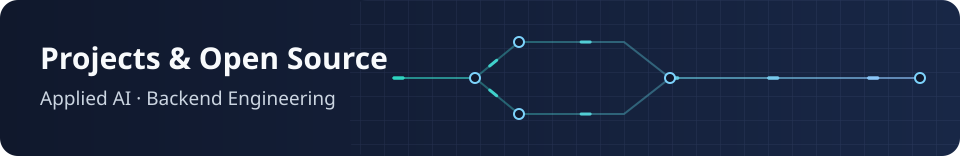

  

<h1 align="center">Harsheet Dwivedi</h1>

  <strong>AI/ML Engineer · Open-Source Contributor</strong> 
  B.Tech in Computer Science & Engineering · BML Munjal University, 2025–2029 
  Gurgaon, India

  
  

  <a href="#featured-projects">Projects</a> ·
  <a href="#open-source">Open source</a> ·
  <a href="#technical-stack">Technical stack</a>

---

I build applied AI and backend projects, with a focus on monitoring multi-agent systems, forecasting from telemetry, and making test workflows reliable. I’m looking for an **AI/ML internship** where I can work on models and the systems that make them usable.

> **Ranked 39th out of 26,000+ participants** at India Innovates 2026 with JanSamvaad, a voice-first municipal grievance platform.

## Featured projects

| Project | What it demonstrates |
| :--- | :--- |
| **[Sunniva Safeguard](https://github.com/Harsh33t/Sunniva-Safeguard)** | Defensive monitoring for multi-agent AI. Tracks messages and trust scores, visualizes agent communication, and isolates suspicious links. |
| **[Sunniva Dynamics](https://github.com/Harsh33t/Sunniva-anti-ddos)** | An offline research prototype that uses recent network activity to forecast risk and shows the evidence behind each warning in a replay dashboard. |
| **[Environment Readiness Orchestrator](https://github.com/Harsh33t/Enviornment-readiness-Orchestrator-)** | A cloud testing prototype with mock preflight checks, operator-approved setup, isolated test runs, and bounded cleanup retries. |
| **[Louigee Kart](https://github.com/Harsh33t/Louigee-KART)** | A 3D browser racer with procedural visuals, AI opponents, arcade drifting, and per-mode time records. [Play the demo](https://louigee-kart.vercel.app/) |

[Browse all public repositories](https://github.com/Harsh33t?tab=repositories)

## Open source

- **[Meshery](https://github.com/meshery/meshery) · CNCF / Layer5** — contributed AI and backend features to the cloud-native management platform.
- **GirlScript Summer of Code** — contributor in 2025 and 2026.
- **Hacktoberfest** — contributor in 2025.

## Technical stack

| Area | Tools |
| :--- | :--- |
| **Languages** | Python, Java, JavaScript, Go, SQL |
| **Machine learning** | PyTorch, YOLOv8, OpenCV, PennyLane, NumPy, pandas, Matplotlib, LLMs |
| **APIs and web** | FastAPI, React, Next.js, Streamlit, HTML/CSS |
| **Infrastructure and tooling** | PostgreSQL, Docker, GitHub Actions, Linux, Git, Raspberry Pi |

## Certifications

- **Machine Learning Specialization** — DeepLearning.AI and Coursera
- **Generative AI Fundamentals** — Google Cloud Skills Boost